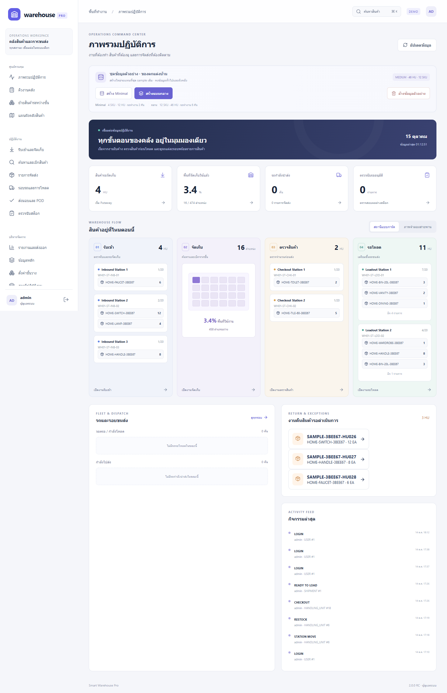
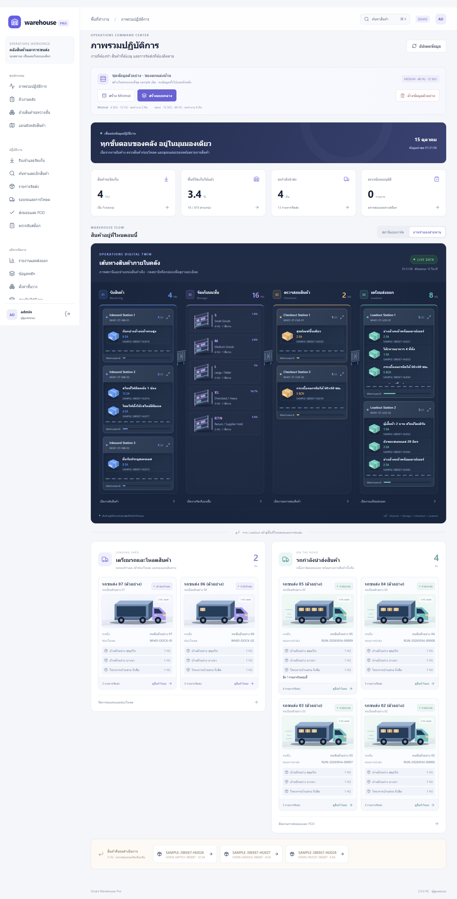
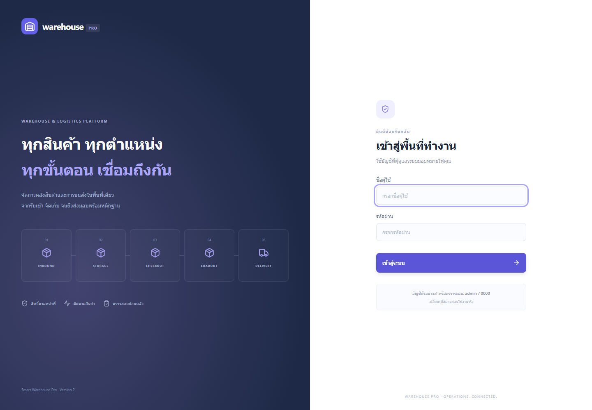

# Smart Warehouse Logistics PRO

Public repository: [Nutnoiz/smart-warehouse-logistics-pro](https://github.com/Nutnoiz/smart-warehouse-logistics-pro)

เวอร์ชันใหม่แยกจาก Smart Warehouse Logistics เดิม ใช้ฐานข้อมูลและพอร์ตของตนเอง



## ภาพจำลองสายพาน

Dashboard มีปุ่ม **สร้าง 1 สินค้า Inbound**, **สร้าง Minimal**, **สร้างแบบกลาง**, **สร้างแบบเยอะ** และ **ล้างข้อมูลตัวอย่าง** สำหรับผู้ดูแลใน Demo mode
ข้อมูลตัวอย่างเป็นสินค้าแต่งบ้าน/ปรับปรุงบ้านทั่วไป เช่น หลอด LED ก๊อกน้ำ โคมไฟ กระเบื้อง สุขภัณฑ์ ตู้เสื้อผ้า โต๊ะ และชั้นวาง
แบบทีละขั้นมี 1 HU ที่ Inbound เท่านั้น ยังไม่จัดเก็บหรือสร้าง Shipment; Minimal มี 4 SKU / 12 HU / รถทำงาน 2 คัน; แบบกลางมี 12 SKU / 46 HU / รถทำงาน 6 คัน; แบบเยอะมี 12 SKU / 178 HU / รถทำงาน 16 คัน (เตรียมโหลด 8 คันและกำลังส่ง 8 คัน)
สร้างใหม่จะแทนที่เฉพาะรายการ sample ที่ติดตาม ownership ไว้ ปุ่มล้างลบรายการและประวัติตัวอย่าง แต่คงทะเบียนสินค้า ลูกค้า รถ คนขับ ข้อมูลทั่วไป ผังคลัง และบัญชีผู้ใช้ การสร้างซ้ำใช้ทะเบียนเดิม ไม่สร้างชื่อสินค้าซ้ำ
หากรายการทั่วไปถูกนำมาผสมกับ sample ระบบจะปฏิเสธการล้างจนแยกข้อมูลก่อน การสร้างไม่สำเร็จจะ rollback กลับชุดเดิม
การล้างตัวอย่างจะยังว่างหลัง restart ระบบ ใช้ปุ่มสร้างเพื่อเริ่มชุดใหม่ และปิดเครื่องมือชุดนี้อัตโนมัติใน production

ที่ Dashboard เลือก **ภาพจำลองสายพาน** เพื่อดูภาพกระบวนการรับเข้า → ชั้นวาง → Checkout → Loadout ที่ออกแบบใหม่
พื้นที่รถเตรียมโหลดและรถกำลังนำส่งแยกอยู่ส่วนล่าง รองรับรถหลายคันและหลาย Shipment ในรถคันเดียว
จองรายการส่ง ถอนจอง สแกน HU ยืนยันโหลดครบ และปล่อยรถได้ที่หน้ารอบรถเท่านั้น หน้า Shipment/Loadout แสดงสถานะและลิงก์ไปยังรอบรถ ไม่โหลดซ้ำอีกช่องทาง รายการที่จองแล้วหายจากคิวรถอื่น และระบบปฏิเสธการจองจากหน้าจอเก่า
หน้าเพิ่มลูกค้ามีช่องเบอร์โทร (ไม่บังคับ) และส่งต่อเบอร์โทรพร้อมที่อยู่ไปยังรายละเอียดปลายทางของ Shipment ที่สร้างใหม่
กดหัวสถานีเพื่อดูสินค้า กดกล่องเพื่อทำขั้นตอนต่อไปหรือจัดเก็บคืน และกดรถเพื่อดูรายการในรอบ ระบบจำมุมมองที่เลือกไว้และอัปเดตข้อมูลทุก 15 วินาที
เลือก **สถานีแบบการ์ด** เพื่อกลับไปมุมมองเดิมของ V2
คลิก S / M / L / XL / RTN จะเปิด Rack ของโซนตรง ๆ หากมีหลาย Rack จะมีตัวเลือกเฉพาะชั้นในโซนนั้น





## เริ่มใช้งาน Windows

1. ติดตั้ง Python 3.12+ และ Node.js 22+
2. ดับเบิลคลิก `SETUP.cmd` ครั้งแรก
3. ดับเบิลคลิก `START_SMART_WAREHOUSE.cmd`
4. เปิด http://localhost:5180 — API http://127.0.0.1:8010/docs
5. บัญชี demo: `admin / 0000`

ปิดหน้าต่าง Backend และ Frontend เพื่อหยุดระบบ บัญชี demo ใช้เฉพาะการตรวจระบบ
หรือใช้ `STOP_SMART_WAREHOUSE.cmd` เพื่อหยุดเฉพาะ process ของโปรเจกต์ที่พอร์ต 8010/5180
ฐานข้อมูล demo: `backend/warehouse-pro.db` ไม่อ่านฐานข้อมูลจากโปรเจกต์เดิม

## สิ่งที่เพิ่มใน V2

- UI ใหม่: sidebar ตามงาน, Command Center, live station cargo, fleet cards หนึ่งคันต่อรอบ, responsive mobile
- ค้นหา SKU / HU / Lot / ตำแหน่งด้วย Ctrl+K และเปิดหน้าค้นหาเพื่อเบิกสินค้า
- คิวงานคลัง พร้อมสถานะเริ่มงานและปิดงานจากการเคลื่อนย้ายจริง
- ย้ายเต็ม HU ระหว่างตำแหน่งด้วยตัวเลือกโซน → ชั้น → Bay → Level → Position
- ตรวจนับสต็อก: เจ้าหน้าที่บันทึก → ผู้จัดการคนอื่นอนุมัติ → ปรับยอดและบันทึก movement ใน transaction เดียว
- ผลตรวจนับที่สต็อกหรือ movement เปลี่ยนไปแล้วจะอนุมัติไม่ได้ ต้องปฏิเสธและตรวจใหม่
- บัญชีผู้ใช้ห้าบทบาท ตรวจสิทธิ์ที่ API: Admin, Manager, Operator, Logistics, Viewer
- เปลี่ยนรหัสผ่าน / รีเซ็ต / ปิดบัญชี / เปลี่ยนสิทธิ์ แล้วเพิกถอน token เดิม
- จำกัดการล็อกอินผิด 8 ครั้งใน 15 นาทีต่อชื่อบัญชี
- Audit ระบุผู้ทำรายการสำหรับ service workflows และส่วน Pro
- รายงานสต็อกแยกตามหน่วย ไม่รวม EA กับ KG และ export CSV รองรับภาษาไทยพร้อมป้องกัน spreadsheet formulas
- หลักฐาน POD ตรวจ authentication และไม่ cache ใน PWA
- Guard configuration: production ห้ามใช้ SQLite, demo mode, secret สั้น และ bootstrap password แบบ demo

## Workflow ที่สืบทอดและตรวจ regression

สินค้า: รับเข้า → Pending Putaway → จัดเก็บ → เบิกจาก Rack/ค้นหาสินค้า → Checkout (QC/ตัวอย่าง ไม่บังคับส่ง) → สร้าง Shipment ทั้งหมด/บางส่วน → Loadout → เลือกรถที่จอดพร้อมแล้ว → สแกน HU → ออกเดินทาง → ถึงปลายทาง → POD

รถ: รอบรถขนส่ง → ลงทะเบียนรถมาถึง (รถและคนขับครั้งเดียว) → เข้าช่องโหลด → เพิ่มหลาย Shipment/สแกนบนหน้ารอบรถ → ยืนยันโหลดครบ → ปล่อยรถออก ไม่กรอกข้อมูลรถซ้ำทุก Shipment

รายละเอียดการย้อนขั้นตอนและข้อป้องกัน: [STATION_WORKFLOW.md](docs/STATION_WORKFLOW.md)

ส่งไม่สำเร็จ → Return Station → ตรวจ/เลือก disposition → Return Rack หรือชั้นปกติ

สินค้าบางส่วนที่เบิกออกจะมี HU ใหม่และเก็บส่วนที่เหลือกลับตำแหน่งเดิม การจัดส่งและรอบรถมีประวัติย้อนหลัง

## การทดสอบ

```powershell
cd backend
.venv\Scripts\python.exe -m pytest -q
cd ../frontend
npm run build
npm test
```

ดู `docs/PRODUCTION_READINESS.md` สำหรับขอบเขต release, ข้อจำกัด และ gate ก่อนขาย/ใช้งานจริง
ดู `docs/UAT.md` สำหรับขั้นตอนตรวจรับ และ `docs/OPERATIONS.md` สำหรับ backup / restore

เวอร์ชันนี้เป็น Release Candidate สำหรับตรวจรับ ไม่ใช่การรับรองว่า production ทุกขนาดผ่าน load/concurrency/security audit แล้ว
